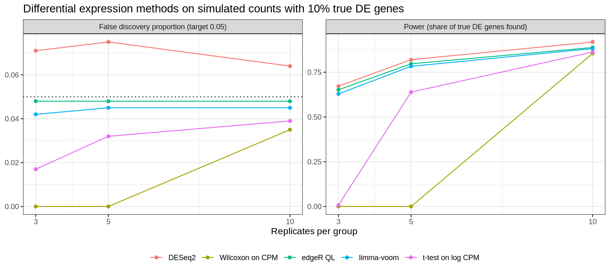
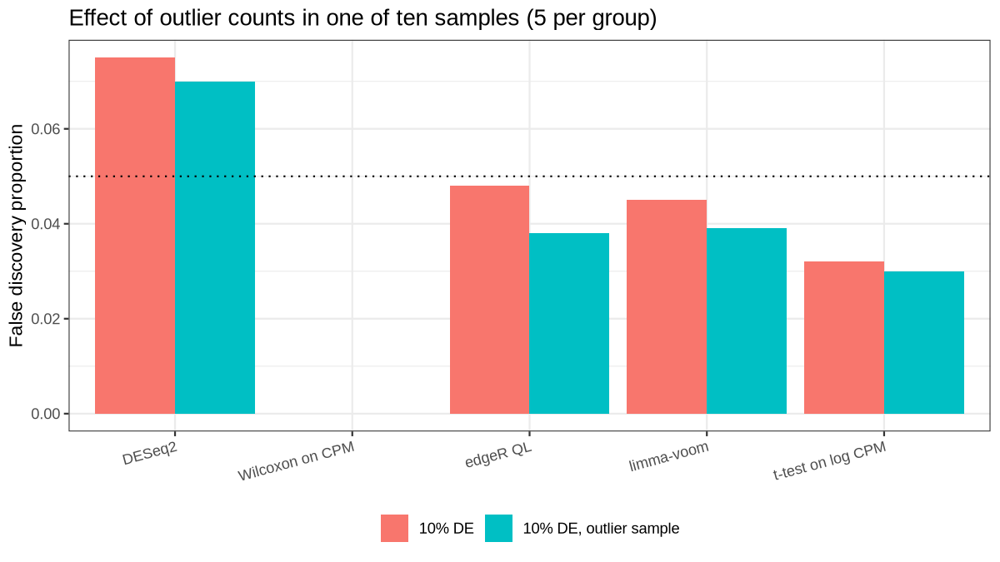

# Differential expression methods for bulk RNA-seq: a simulation benchmark

DESeq2, edgeR, and limma-voom are the standard tools for bulk RNA-seq differential expression, and simpler tests on normalized counts still appear in practice. This project compares them on simulated counts where the truly changed genes are known. It measures how well each method holds its promised false discovery rate, how much it finds, how both depend on the number of replicates, and what happens when one sample carries outlier counts.

A companion analysis of real data, a paired-design study of BET inhibition in T cells, is in [rnaseq-deseq2-paired-design](https://github.com/pkamand1/rnaseq-deseq2-paired-design).

## Simulation

Each simulated experiment has:
- 6,000 genes with log-normally distributed mean counts.
- Negative binomial dispersion that falls with expression and scatters around that trend, as in real data.
- Sample-specific library sizes.
- Two groups, with 10% of genes changed by an absolute log2 fold change between 0.5 and 2.

Scenarios vary the replicates per group (3, 5, 10), include a complete null with no changed genes, and add a sample in which 1% of genes carry tenfold outlier counts. Each scenario was simulated 20 times.

The methods compared are:
- DESeq2: Wald test, with its default independent filtering and Cook's distance outlier handling.
- edgeR: quasi-likelihood F-test, with TMM normalization and `filterByExpr`.
- limma-voom: on the same filtered, normalized data.
- A Welch t-test on log CPM.
- A Wilcoxon rank-sum test on CPM.

All p-values are adjusted by Benjamini-Hochberg at 5%.

## Results



| Replicates per group | Method | Genes called | False discovery proportion | Power |
| --- | --- | --- | --- | --- |
| 3 | DESeq2 | 434 | 7.1% | 67% |
| 3 | edgeR QL | 411 | 4.8% | 65% |
| 3 | limma-voom | 394 | 4.2% | 63% |
| 3 | t-test on log CPM | 4 | 1.7% | 1% |
| 3 | Wilcoxon on CPM | 0 | n/a | 0% |
| 5 | DESeq2 | 532 | 7.5% | 82% |
| 5 | edgeR QL | 502 | 4.8% | 80% |
| 5 | limma-voom | 492 | 4.5% | 78% |
| 5 | t-test on log CPM | 396 | 3.2% | 64% |
| 5 | Wilcoxon on CPM | 0 | n/a | 0% |
| 10 | DESeq2 | 589 | 6.4% | 92% |
| 10 | edgeR QL | 560 | 4.8% | 89% |
| 10 | limma-voom | 554 | 4.5% | 88% |
| 10 | t-test on log CPM | 539 | 3.9% | 86% |
| 10 | Wilcoxon on CPM | 532 | 3.5% | 86% |

| Complete null (no changed genes) | DESeq2 | edgeR QL | limma-voom |
| --- | --- | --- | --- |
| Runs with any false call, 3 per group | 13 of 20 | 0 of 20 | 0 of 20 |
| Runs with any false call, 5 per group | 13 of 20 | 1 of 20 | 1 of 20 |
| Runs with any false call, 10 per group | 10 of 20 | 1 of 20 | 1 of 20 |
| Most false calls in one run | 6 | 1 | 1 |

What the numbers say:
- The three dedicated methods find nearly the same genes. Power differs by only a few points among DESeq2, edgeR, and limma-voom at every sample size.
- edgeR and limma-voom hold the 5% target exactly. Under the complete null they produce a false call in about one run in twenty, which is what a 5% error rate means.
- DESeq2 is slightly liberal in this simulation. Its false discovery proportion runs 6% to 8%, and under the null it calls one or two genes in most runs. DESeq2 shrinks each gene's dispersion toward the fitted trend, which helps power but can understate dispersion for genes that are unusually variable. The quasi-likelihood F-test in edgeR and the precision weights in limma account for that uncertainty. This is a property of this simulation, in which dispersion scatters freely around the trend; it is not a verdict on DESeq2 in general.
- Simple tests fail at small sample sizes. With 3 or 5 replicates the Wilcoxon test cannot reach significance at all after multiple testing correction, because the smallest p-value a rank test can produce with so few samples is too large. The t-test finds almost nothing with 3 replicates. Both become reasonable only at 10 per group.
- One sample with outlier counts did not break any method. At 5 per group, no method's false discovery proportion rose (DESeq2 7.0%, edgeR 3.8%, limma-voom 3.9%), and power fell by only 2 to 3 points: DESeq2's Cook's distance handling and the moderated methods absorbed the outliers.



The practical reading is that the choice among DESeq2, edgeR, and limma-voom matters less than the number of biological replicates, which raises power from about 65% to about 90% between 3 and 10 per group. Rank-based or plain t-tests should not be used on small RNA-seq experiments.

## Repository layout

```
R/benchmark.R                          simulation, all five methods, scoring, figures
results/tables/de_benchmark_summary.csv  means over 20 simulated experiments per scenario
results/tables/de_benchmark_all_runs.csv every run
results/tables/null_scenario.csv         false calls under the complete null
results/figures/                         figures above
environment.yml                          conda environment
```

## How to run

```
mamba env create -f environment.yml
mamba activate bulk-rnaseq-de-benchmark
Rscript R/benchmark.R 20
```

The full benchmark takes about fifteen minutes.

## References

Law, C. W., Chen, Y., Shi, W., & Smyth, G. K. (2014). voom: Precision weights unlock linear model analysis tools for RNA-seq read counts. *Genome Biology, 15*(2), R29.

Love, M. I., Huber, W., & Anders, S. (2014). Moderated estimation of fold change and dispersion for RNA-seq data with DESeq2. *Genome Biology, 15*(12), 550.

Lund, S. P., Nettleton, D., McCarthy, D. J., & Smyth, G. K. (2012). Detecting differential expression in RNA-sequence data using quasi-likelihood with shrunken dispersion estimates. *Statistical Applications in Genetics and Molecular Biology, 11*(5).

## Author

Patricia K. Kamanda. Released under the MIT License.
